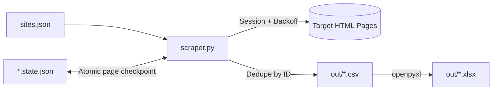

# Resumable Web Scraper

A config-driven Python CLI scraper that extracts paginated HTML into deduplicated CSV and formatted `.xlsx` files, with atomic page-level checkpointing and exponential backoff.

## Architecture



## Quick Start (Under 2 Minutes)

```bash
python3 -m venv .venv && source .venv/bin/activate
pip install -e ".[dev]"
pytest -v
python3 scraper.py --site quotes --fresh
```

## Usage

```bash
python3 scraper.py --all                 # Scrape all configured sites
python3 scraper.py --site books          # Scrape one site (resumes from checkpoint)
python3 scraper.py --site books --fresh  # Ignore checkpoint and re-crawl
```

## Adding a Site

Add a block to `sites.json`—no Python changes required:

```json
{
  "name": "quotes",
  "url": "https://quotes.toscrape.com/",
  "max_pages": 1,
  "delay": 0.5,
  "id_field": "text",
  "item_selector": "div.quote",
  "fields": {
    "text":   { "selector": "span.text", "regex": "“(.+?)”" },
    "author": { "selector": "small.author" },
    "tags":   { "selector": "a.tag", "all": true }
  }
}
```

## Scope & Ethics

This tool is built for public data extraction where permitted by the site's `robots.txt` and Terms of Service. It reuses a single HTTP session with polite request delays and does not implement CAPTCHA solving, proxy rotation, or bot-detection bypass.

## Verification & Automated Testing

Verified through automated unit tests (`pytest`), static type-checking (`mypy --strict`), linting (`ruff`), and clean executions against public sandboxes (`books.toscrape.com` and `quotes.toscrape.com`). See [CHANGELOG.md](CHANGELOG.md) for defect history and version details.

## License

MIT
